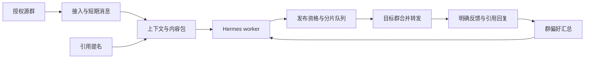

# pullshit 总体设计

pullshit 发现、筛选和搬运有趣或猎奇的内容，并从目标群反馈中改进。发布数量是上限，允许没有合格内容。技术和维护约定见 [AGENTS.md](../AGENTS.md)，任务状态见[开发 TODO](phase-1-todo.md)。

## 1. 业务流程

来源到目标的路由由配置明确授权。模型提供分析，程序校验范围、期限、撤回、图片检查、暂停、重复和预算，并执行平台操作。

## 2. 接入边界：pullshit 控制流程，agent 提供能力

Python 主程序管理规则、状态和调度；独立 Hermes worker 执行选材及引用反馈解释。每任务限定内容包、目标群、工具、时限和费用预算。工具支持补上下文、查看图片、读取群偏好和提交分析；程序持有 QQ 发送凭据。

worker 使用独立解释器和任务级 `HERMES_HOME`，关闭长期记忆与轨迹保存。任务结束清理目录，超时或取消结束整个进程组。Hermes 使用公开扩展接口，依据及固定版本见[Agent 接入调研](reserach/agent-integration.md)。

## 3. 模块与依赖

| 模块 | 职责 |
| --- | --- |
| ingestion | NapCat 认证连接、echo 回执、归一化消息／撤回／表情、平台读取与发送 |
| content | 有界上下文、消息窗口、内容指纹、图片访问及文件缓存 |
| agent | 任务协议、Hermes 插件、受限工具、结果校验、用量与取消 |
| publishing | 发布资格、100 节点分片、持久队列、频率与流量、发送恢复 |
| feedback | 精确归因、重复信号合并、反馈解释、偏好更新与回滚 |
| storage | 六类业务状态的 SQL、事务、期限与文件空间回收 |
| runtime / entrypoints | 依赖组装、运行调度、重连、维护、配置与操作入口 |

`contracts.py` 定义共享业务类型。存储读取这些类型；应用流程依赖 repository 和平台接口；NapCat 与 Hermes 载荷在各自适配模块内转换。业务模块通过接口交换内容包与结果，接口详见[接口文档](interfaces.md)。

## 4. 内容与发布

引用关系优先。同作者短时间连发按默认 60 秒安静窗口和 5 分钟最长等待归并，最多 500 条。引用和转发有深度、节点、回取次数及总时限。嵌入节点使用内部引用，补取范围绑定外层授权消息。

文本、图片、链接和有限深度合并转发形成内容包。缺失、循环、截断和无法检查的媒体带明确原因。指纹关注正文与媒体内容，排除平台 ID、昵称和临时访问地址。自身消息作为上下文证据保存，发现流程过滤自身消息。

每个内容包按原记录顺序转发。实际发送节点数最多 100；媒体限制也可触发分片。分片共用内容包身份，逐片保留状态与回执；编号写入首节点正文，仍计为同一节点。

发布状态为 `queued → sending → sent / failed / unknown / cancelled`。事务同时预留当日额度和本次发送状态。重启将中断的 `sending` 转为 `unknown`，核对后确认。明确失败允许按片重试；候选到期取消待发片。

## 5. 数据与清理

| 表 | 用途与期限 |
| --- | --- |
| messages | 归一化消息及撤回，默认 3 天 |
| candidates | 内容包、判断与处理状态，最长 7 天 |
| deliveries | 分片队列和回执；内容最多 7 天，精简去重索引 90 天 |
| feedback | 可归因的具体信号，最长 7 天 |
| group_state | 暂停、群偏好、汇总与有限回滚快照 |
| daily_budgets | 日范围额度预留及汇总，默认 30 天 |

连接和错误诊断使用脱敏轮转日志。任务内记录已访问引用；成功回取形成短期消息。媒体使用内容寻址文件和期限元数据。

复制、回取和缓存复用保持原有期限。所有查询和执行阶段检查期限。启动补做清理，每小时删除过期内容，每日 UTC 00:30 回收空间，使用 SQLite 增量回收及 WAL 截断。读锁阻塞回收时报告并重试。

媒体目录默认上限 2 GiB，过期和未引用文件先清理，空间仍不足时停止新增下载。下载按实读字节、发布按应用载荷和媒体大小计量；平台底层网络统计由部署侧提供。

## 6. 反馈与偏好

确切引用和明确反馈命令先定位发布。表情保留增删状态并标为语义未知。附近聊天不参与首版学习。无反馈保持未知。

同一成员对同一内容包贡献合并；明确命令优先。每天基于最多 7 天的有效信号更新群级题材／风格权重，至少 3 次不同发布和 3 名不同成员，每次变化最多 0.05。保存上一版本以回滚。成员身份随原信号到期删除，群级汇总持续保留。

硬规则通过管理员配置与控制面维护。引用、合并转发和模型输入中的命令保持为内容。控制命令校验真实发送者及所在群。

最后修改时间：2026-10-12T17:47:09Z
模型署名：GPT-6
