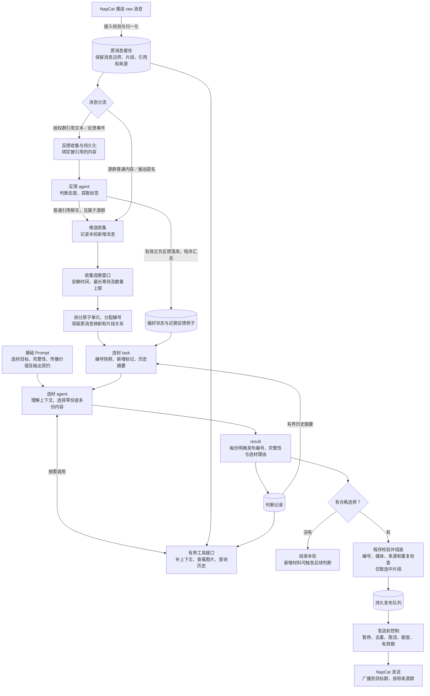

# pullshit 总体设计

pullshit 发现、筛选和搬运有趣或猎奇的内容，并从目标群反馈中改进。发布数量是上限，允许没有合格内容。技术和维护约定见 [AGENTS.md](../AGENTS.md)，任务状态见[开发 TODO](phase-1-todo.md)。

## 1. 业务流程

配置分别授权来源集合 `S` 与目标集合 `T`。来自 `s ∈ S` 的内容只选材一次，选中后广播至 `T − {s}`；内容包包含多个来源群时，排除全部来源群。来源范围按实际选中的内容计算。模型提供分析，程序校验范围、期限、撤回、图片检查、暂停、重复和预算，并执行平台操作。

### 1.1 消息与状态的分层

图中的 `raw` 指 NapCat 原生推送的 OneBot 事件，处于平台输入层。接入适配器将授权事件转换为 `ChatEvent`／`ChatMessage`，原消息缓存保存其中的消息边界、平台片段及来源关系；具体持久化字段见[接口文档](interfaces.md#共享对象)。原生事件、归一化原消息和后续拆分的原子单元分别定义，缓存的字段保真验收见[开发 TODO](phase-1-todo.md)。

| 层次 | 内容与职责 |
| --- | --- |
| raw 事件 | NapCat 输入；携带原消息及平台事件字段，供接入校验和适配 |
| 原消息缓存 | 保存未做选材拆分的消息、原消息 ID、账号、群、作者、时间、片段和引用；支持追溯与有界补查 |
| 观察包 | 收集一段群内对话，标明本轮新增消息；为理解和选材提供材料 |
| task 与原子单元 | 从观察包分配任务局部编号，保存编号到原消息／片段的映射；附偏好、历史摘要及工具预算 |
| result 与判断记录 | 保存零份或多份选择、实际发布编号及判断理由；供复用、重评和审计 |
| 发布内容与队列 | 按发布编号取出原片段，形成独立发布内容和持久投递任务；保留目标、状态及回执 |

一条原消息可以同时含文字、图片、提及和引用。原子单元保留它们的共同原消息身份与原始顺序；程序通过映射组装所选文字和图片。原消息缓存、判断记录和发布队列承担各自职责，观察范围与实际发送范围分别保存。

### 1.2 两条任务支路

候选支路从源群 `S` 收集普通内容或显式 `/搬` 提名。观察窗口负责收集，选材 agent 逐份判断内容的语义完整性与跨群传播价值。发布内容应对不认识源群成员的目标读者成立；成员身份争论、点名喊话等材料须具有脱离具体人物关系仍能成立的笑点或猎奇信息。完整性理由与选材理由分别说明这些判断，程序校验编号、媒体与来源等可核对的事实。选材质量通过真实样本与反馈验收，允许整轮没有合格内容。

反馈支路在授权范围 `S ∪ T` 内绑定确切引用内容或已发布内容，产出正面、负面或未知态度以及题材标签。有效反馈形成近期例子，满足汇总条件时更新偏好状态；普通引用聊天按来源资格回到候选支路。反馈解释与选材使用独立任务会话，状态通过持久存储传递。

基础 Prompt 定义目标与输出契约，偏好状态提供口味信号，程序维护群权限与发布约束。选材任务从这些来源读取各自输入；工具访问原消息、图片及历史记录时共用任务预算。 图中偏好及历史到 task 的箭头表示读取依赖，任务调度由新增消息窗口、显式提名、操作员重评及未完成任务恢复决定。

## 2. 接入边界：pullshit 控制流程，agent 提供能力

Python 主程序管理规则、状态和调度；独立任务 worker 按角色执行选材及引用反馈解释。选材任务限定内容包、广播目标集合、工具、时限和费用预算；各目标群偏好按群等权汇总供一次选材参考。引用反馈任务绑定具体目标群。工具支持补上下文、查看图片、读取群偏好和提交分析；程序持有 QQ 发送凭据。

候选支持通用 LLM 与 SystemOne 决策通道；反馈使用通用 LLM。通用 LLM 经 Hermes 执行工具对话，SystemOne worker 用 Choice 分组及 Noul 校验构造相同的明确发布清单，纯文本决策通过视觉 LLM 获取图片描述。两者共用工具授权、快照、预算与发布校验。角色配置见[配置说明](configuration.md#候选与反馈的-api-通道)。

worker 使用独立解释器和任务级 `HERMES_HOME`，关闭长期记忆与轨迹保存。任务结束清理目录，超时或取消结束整个进程组。Hermes 使用公开扩展接口，依据及固定版本见[Agent 接入调研](reserach/agent-integration.md)。

## 3. 模块与依赖

| 模块 | 职责 |
| --- | --- |
| ingestion | NapCat 认证连接、echo 回执、归一化消息／撤回／表情、平台读取与发送 |
| content | 群对话窗口、任务编号快照、有界上下文、精确发布清单、内容指纹、图片访问及文件缓存 |
| agent | 任务协议、Hermes 插件、受限工具、结果校验、用量与取消 |
| publishing | 发布资格、普通消息分片、广播持久队列、频率与流量、发送恢复 |
| feedback | 精确归因、重复信号合并、反馈解释、偏好更新与回滚 |
| storage | 六类业务状态的 SQL、事务、期限与文件空间回收 |
| runtime / entrypoints | 依赖组装、运行调度、重连、维护、配置与操作入口 |

`contracts.py` 定义共享业务类型。存储读取这些类型；应用流程依赖 repository 和平台接口；NapCat 与 Hermes 载荷在各自适配模块内转换。业务模块通过接口交换内容包与结果，接口详见[接口文档](interfaces.md)。

操作员通过本机认证的模拟转发 HTTP 接口指定节点 QQ 字段及纯文本。entrypoints 处理 HTTP、认证、幂等与限流，publishing 构造含固定模拟说明的节点并核对回读，storage 保存有界文件回执。接口绑定预期账号，复查目标授权和暂停，使用独立操作员限流；自动策展通过内容包与发布队列执行。模拟接口不调用 agent。

## 4. 内容与发布

群内连续对话按默认 60 秒安静窗口和 5 分钟最长等待收集，最多 500 条；窗口表示观察范围。候选的 trigger_refs 持久记录本轮新增消息，普通发现复用已分配记录，引用提名可显式触发重评。引用和转发有深度、节点、回取次数及总时限。嵌入节点记录可验证的外层消息，补取范围绑定该账号及授权源群。

文本、图片、链接和有限深度合并转发形成内容包。缺失、循环、截断和无法检查的媒体带明确原因。指纹关注正文与媒体内容，排除平台 ID、昵称和临时访问地址。自身消息作为上下文证据保存，发现流程过滤自身消息。

每条 QQ 消息按平台片段拆成原子单元，保留原消息、发送者、时间、引用及外层来源关系。任务快照分配 U001 等局部编号；追加上下文保留已有编号并递增版本。文字及可读取图片可选择发布，提及、引用和包装片段供理解。agent 给出零份或多份 selections，每份明确 publish_ids、完整性及判断理由。程序校验快照、编号范围、片段资格、所选图片检查和新增输入，再为每份选择建立独立、不可覆盖的发布候选。所选片段按原时间及片段顺序拼成普通文本和图片；记录间文字换行。单条最多 100 个消息段；媒体限制也可触发分片。每个广播目标独立保留分片状态与回执，内容指纹按实际选中的正文和图片计算，在同目标幂等去重；已进入队列或已尝试发送的相同图片核心及完全覆盖的文字单元抑制重复发布。包含新增图片的完整组合可独立判断。内容包 ID 与分片编号保存在业务状态中。每群的暂停、间隔、日额度和发送结果独立生效；某目标的授权变化只取消该目标的待发任务。

上下文 get_context 使用已有编号为锚点，提供引用、同群相邻消息和历史判断摘要。默认每任务最多扩展 2 次，累计 40 个单元、16000 字符、4 张图片，相邻读取窗口为锚点前后 600 秒；明确引用可跨更长间隔，仍受期限和累计预算约束。扩展材料标为历史上下文，每份选择须包含本轮新增内容；历史摘要记录已判断、已选中状态，发布记录另行去重。语义完整性由 agent 给出理由，程序核对素材可读性及实际发送清单。

发布状态为 `queued → sending → sent / failed / unknown / cancelled`。事务同时预留当日额度和本次发送状态。重启将中断的 `sending` 转为 `unknown`，核对后确认。明确失败允许按片重试；候选到期取消待发片。

## 5. 数据与清理

| 表 | 用途与期限 |
| --- | --- |
| messages | 归一化消息及撤回，默认 3 天 |
| candidates | 观察包、新增消息分配、原子判断摘要、独立发布内容及清单，最长 7 天 |
| deliveries | 分片队列和回执；内容最多 7 天，精简去重索引 90 天 |
| feedback | 可归因的具体信号，最长 7 天 |
| group_state | 暂停、群偏好、汇总与有限回滚快照 |
| daily_budgets | 日范围额度预留及汇总，默认 30 天 |

连接和错误诊断使用脱敏轮转日志。任务内记录已访问引用；成功回取形成短期消息。媒体使用内容寻址文件和期限元数据。

模拟接口的幂等意图与回执使用环境内私有 JSON 文件，保存请求摘要及回执，最多 500 条、保留 7 天。发送意图和成功回执通过原子替换及 fsync 落盘；重启后保留结果不确定的请求，查询与同键重放复用已有结果。

复制、回取和缓存复用保持原有期限。所有查询和执行阶段检查期限。启动补做清理，每小时删除过期内容，每日 UTC 00:30 回收空间，使用 SQLite 增量回收及 WAL 截断。读锁阻塞回收时报告并重试。

媒体目录默认上限 2 GiB，过期和未引用文件先清理，空间仍不足时停止新增下载。下载按实读字节、发布按应用载荷和媒体大小计量；平台底层网络统计由部署侧提供。

## 6. 反馈与偏好

确切引用定位已发布内容或群内可读取的原消息。成员在授权源群或目标群引用消息并自然表达喜好时，反馈意图先落库，再由 agent 解释正面、负面或未知态度，并提取题材标签。普通引用聊天由 agent 区分并保持普通内容发现。读取原素材可建立仅供反馈使用的内容包，反馈处理独立于发布队列。表情保留增删状态并标为语义未知。附近聊天不参与学习。无反馈保持未知。

反馈调节的输入包含成员、内容身份、态度和题材标签。同一成员对同一内容的权重贡献合并，明确命令优先。`unknown` 保留为记录，例子查询与学习使用有效正负方向；表情通知按未知语义保存。成员身份随原信号到期删除，群级汇总持续保留。

| 通道 | 产物与作用范围 | 采用时机与条件 |
| --- | --- | --- |
| 近期反馈例子 | 目标群及来源群每群最多 6 条有效正负例子，附题材标签、态度、原话及有界素材摘要 | 每轮选材读取，可在权重汇总前供模型参考 |
| 群级标签权重 | 运行层对目标群逐群学习，保留上一版本供回滚 | 每个 UTC 日基于最多 7 天的有效信号汇总；每标签至少 3 份不同内容及 3 名不同成员，每次变化最多 0.05 |

目标群权重按群等权汇总进入一次选材，并用于各目标的队列优先级。广播范围按来源排除规则确定，每个目标独立执行发送控制。

反馈信号作用于题材／风格偏好，基础 Prompt、发布规则和模型参数通过各自的维护入口调整。反馈效果分层验证：接收及归因、语义解释、例子或权重变化、后续任务采用、实际选材质量；单次反馈落库或模拟测试通过仅证明其对应环节。

待解释反馈保存在 feedback 的 payload 中，取消或重启后由运行层恢复调度，同一事件保持幂等。清晰的正负反馈在 auto 模式且发送开启时收到引用确认，每群每分钟最多 5 次，群发布暂停期间仍可确认。确认发送前保存意图；回执不确定的确认保持单次尝试。

硬规则通过管理员配置与控制面维护。引用、合并转发和模型输入中的命令保持为内容。控制命令校验真实发送者及所在群。

最后修改时间：2026-10-17T18:18:45Z
模型署名：GPT-6
