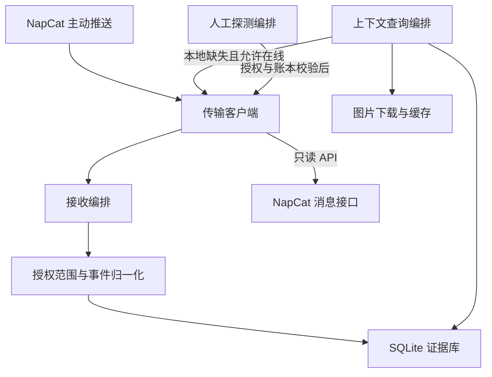

# QQ 接入层设计

本文定义 QQ 接入层与应用编排、证据存储的配合；项目整体模块划分以[总体设计](design.md#32-分层与模块)为准。开发任务见[开发 TODO](phase-1-todo.md)，有日期的实测证据见[验证记录](p0-implementation.md#上下文查询验证)。

## 职责与代码边界

QQ 登录和平台消息由外部 NapCat 提供。pullshit 的 QQ 接入层处理平台通信和事件契约；接收、上下文组装和人工发送是应用层的不同流程，由应用层调用接入与证据模块完成。

| 模块 | 层级与职责 | 对外接口和结果 |
| --- | --- | --- |
| [adapters/qq/napcat.py](../src/pullshit/adapters/qq/napcat.py) | QQ 接入：联合 WebSocket、Bearer 认证、账号识别、单读循环、事件队列、echo 关联、API 时限与权限白名单 | `NapCat.event()` 返回原始事件；`NapCat.call()` 返回 API 数据或脱敏错误；`account` 提供已认证运行账号 |
| [adapters/qq/events.py](../src/pullshit/adapters/qq/events.py) | QQ 接入：账号/群过滤、事件与消息段归一化、字符串 ID、去重键、来源与缺失标记 | `normalize()` 返回 `Event` 或忽略结果；消息段保持原始顺序，原始载荷作为证据保留 |
| [storage/store.py](../src/pullshit/storage/store.py) | 数据与证据：SQLite 持久化、迁移、范围隔离、幂等、回取缓存、探测账本和保留期 | `Store.ingest()` 保存事件；`context_message/context_cached` 查询已有证据；账本记录发送及关联反馈 |
| [application/service.py](../src/pullshit/application/service.py) | 应用编排：持续接收、逐事件重读授权、调用归一化和落库、重连与覆盖缺口 | `receive()` 运行只接收流程，退出或限次完成时返回存储计数 |
| [application/context.py](../src/pullshit/application/context.py) | 应用编排：本地优先查询、有界引用和转发展开、身份核对、媒体关联、总预算与部分结果 | `ContextResolver.resolve()` 返回原文、引用/转发结构、附近消息、媒体引用、来源、状态、缺失原因和统计 |
| [application/probe.py](../src/pullshit/application/probe.py) | 应用编排：人工探测请求、路由与操作者校验、配额、持久暂停、逐条意图与回执 | `send_probe()` 执行授权探测并返回账本；异常保留 `failed/unknown/cancelled` 状态 |
| [media/cache.py](../src/pullshit/media/cache.py)、[media/worker.py](../src/pullshit/media/worker.py) | 资源访问与缓存辅助：受限图片下载、哈希文件、读取校验与清理；独立下载进程受调用方时限控制 | 返回媒体元数据或明确缺失原因；私有访问地址留在原始证据中 |
| [entrypoints/cli.py](../src/pullshit/entrypoints/cli.py)、[config.py](../src/pullshit/config.py) | 操作入口与配置：加载环境、注入连接和存储、选择接收/查询/探测流程、校验参数 | 人工 CLI 与已校验配置；各环境存储和凭据独立 |

接入模块提供事实和平台操作，应用编排决定何时接收、补取或执行授权探测。领域层以这些证据为输入，负责内容包、选材与发布决定；平台接口和业务规则的依赖方向遵循总体设计。

## 推送、补取与发送的数据流

### 实时推送路径

1. NapCat 通过联合 WebSocket 主动推送事件，客户端将事件和带 echo 的 API 回执分流。
2. 接收流程取得事件，重新加载授权与连接配置，通过 `normalize()` 校验账号和群范围。
3. 数据层在事务中保存原始与归一化证据，重复事件按去重键识别，自身消息、撤回和表情证据分别标记或关联。
4. 连接中断或事件队列异常时，应用编排记录覆盖缺口并退避重连。覆盖缺口记录中断时间及恢复时间，表示该区间的消息完整性未知。

该路径随收到的事件执行。上下文查询的内容回取额度仅作用于一次查询；持续接收受单连接 2 MiB 帧大小、1000 个待消费事件以及连接状态约束。

### 按需补取路径

1. 操作入口创建查询流程，绑定运行账号、授权群和消息 ID。
2. 先查询本地消息与独立回取缓存；显式开启在线查询后，才允许缺失时调用 `get_msg/get_forward_msg`。
3. 对返回内容核对可验证的身份与范围，保存独立回取证据，继续沿引用或转发结构展开。
4. 在共用预算内组装输出；开启媒体下载后取得图片缓存。达到限制时返回部分结果和原因。

`get_msg` 的一次调用读取一条指定消息，`get_forward_msg` 的一次调用可返回多个节点。每次发起内容请求消耗一次回取额度，失败同样计数；本地、缓存和主动推送分别处理。组装的节点额度计入消息段与转发结构节点，配置定义见[配置说明](configuration.md#上下文查询参数)。

### 受控发送路径

人工探测入口校验请求的操作者、来源路由、目标群、开关和暂停状态，在事务中预留配额和发送意图；每条消息执行前再次检查有效配置与持久暂停。传输客户端只在 `allow_send=true` 时允许 `send_group_msg`，并核对运行账号。发送回执进入探测账本；回执不确定时保留 `unknown`，由人工核对和确认。

接收与上下文查询的连接保持只读。人工探测的操作者字段由本地请求提供，其执行授权依赖本地系统用户与凭据访问权限；该字段用于范围校验和审计。

## 查询与证据

`context` 按运行账号、授权群和消息 ID 组装原文、引用链、有界转发树和媒体引用。账号由认证连接识别；离线查询从该群的消息及回取记录确定唯一账号，存在歧义时要求在线查询。查询范围为源群与目标群白名单的并集，每次处理和回取后重新读取授权。

查询优先读取实时事件库和回取缓存。`--online` 允许使用 `get_msg` 与 `get_forward_msg`；查询连接关闭发送权限。每次内容回取前通过 `get_login_info` 确认账号，每条 `get_msg` 结果核对消息类型、群和消息 ID，以及载荷提供的账号。平台身份或连接配置变化时终止查询，群授权撤销时拒绝交付结果。

引用是明确关系；`nearby` 中的消息只是 `time_neighbor` 线索。附近消息仅从本地按发生时间和接收顺序取前后记录，窗口和数量有上限。平台消息 ID 作为字符串使用，可以为负数；不按 ID 加减寻找前后文。

输出保留发送者、发生时间、自己的消息标记、撤回状态、消息段顺序、来源 `local/cache/platform` 和缺失原因。转发保持节点层级；节点中的群、发送者及回复 ID 属于平台声明。节点标记 `origin_group_verified=false`，其中的回复标记 `embedded_reply_source_unverified`，表示平台声明的来源尚无法核对。

## 预算、失败与缓存

参数集中维护在[配置说明](configuration.md#上下文查询参数)与[默认配置](../config/defaults.json)。整个组装共用节点和文本预算，覆盖原消息、引用、转发及附近消息。内容回取额度统计 `get_msg/get_forward_msg`；登录验证另行计数，也受查询时限约束。CLI 的连接、登录、回取、下载和组装共用总时限，WebSocket 关闭另限 2 秒。

`status=partial` 配合 `issues` 表示内容不完整。典型原因包括 `missing_offline`、`api_rejected`、`transport_error`、`invalid_or_mismatched_payload`、`reply_cycle`、`reply_depth_limit`、`forward_cycle`、`forward_depth_limit`、`node_limit`、`fetch_limit`、`text_limit`、`timeout` 和 `recalled`。超时保留已组装部分；撤回正文作为已有证据保留，停止扩展其引用和媒体。

SQLite schema 2 增加 `context_cache`，按账号、群、类型和引用 ID 隔离原始回取结果、状态、失败原因和核对时间。迁移保留 schema 1 的事件和账本；多个进程在写锁内检查版本。回取结果属于独立证据，实时事件与反馈计数保持各自含义。成功结果受原始事件保留期约束；失败短期缓存后可以重试。`cleanup` 清理超期证据，接收程序在启动和重连时同样清理。

## 图片

`--online --cache-media` 才允许图片下载；离线查询可以验证并读取已有缓存。图片按文件引用关联、按内容 SHA-256 存储；原始访问地址留在私有证据中，查询 JSON 提供哈希、大小、类型和本地路径。附近消息只提供线索；针对该消息单独查询时才处理其图片。

下载失败时，可在剩余预算内重新读取一次经过群和消息身份核对的原消息，以唯一、稳定的图片文件引用匹配新地址，再重试一次；每条原消息每次查询至多重新读取一次。转发节点的地址刷新以已验证的来源消息为前提。下载与重试共同消耗媒体次数，地址刷新消耗内容回取额度。新地址成功后输出 `url_refreshed=true`，重复查询直接验证和复用缓存。

下载检查公共 HTTP(S) 地址、DNS 固定目标、证书、重定向、图片文件头、实际大小和时限。使用可终止的独立下载进程，DNS 或网络等待达到时限后结束该进程。缓存过期、损坏、地址被拒绝、HTTP 拒绝、大小超限、格式不支持和下载超时分别使用 `media_cache_expired`、`media_cache_invalid`、`media_address_rejected`、`media_http_rejected`、`media_size_limit`、`media_type_unsupported`、`media_timeout` 等状态。

## 一手来源

核对日期：2026-10-10。源码能力与部署实测边界分别记录。

- [OneBot 11 消息段](https://github.com/botuniverse/onebot-11/blob/master/message/segment.md)：引用 ID、合并转发 ID 与内联节点结构。
- [OneBot 11 公开 API](https://github.com/botuniverse/onebot-11/blob/master/api/public.md)：`get_msg` 和 `get_forward_msg`。
- [NapCat GetForwardMsg](https://github.com/NapNeko/NapCatQQ/blob/main/packages/napcat-onebot/action/go-cqhttp/GetForwardMsg.ts)：参数兼容及 `messages` 数组；实现同时接受标准的 `message` 数组形状。
- [NapCat 消息构造](https://github.com/NapNeko/NapCatQQ/blob/main/packages/napcat-onebot/api/msg.ts)：消息 ID、序号及转发载荷构造。
- [NapCat 消息 ID 映射](https://github.com/NapNeko/NapCatQQ/blob/main/packages/napcat-common/src/message-unique.ts)：源码使用有界内存映射，旧消息可用性须以固定版本实测确认。

最后修改时间：2026-10-10T11:55:51Z
模型署名：GPT-6
